# AI Placement Intelligence Agent

An AI-powered placement assistant that turns a folder of job descriptions into a searchable knowledge base. It combines structured metadata filtering, semantic retrieval, rank fusion, and a locally hosted LLM to help students search roles, compare opportunities, explore eligibility, and ask questions in natural language.

> **Core idea:** index job descriptions once, retrieve relevant evidence for each question, and use an LLM to produce a contextual answer.

---

## Table of Contents

- [Overview](#overview)
- [Key Features](#key-features)
- [System Architecture](#system-architecture)
- [How the Pipeline Works](#how-the-pipeline-works)
  - [1. Document discovery and ingestion](#1-document-discovery-and-ingestion)
  - [2. Metadata extraction](#2-metadata-extraction)
  - [3. Semantic chunking and embeddings](#3-semantic-chunking-and-embeddings)
  - [4. Storage layer](#4-storage-layer)
  - [5. Hybrid retrieval and rank fusion](#5-hybrid-retrieval-and-rank-fusion)
  - [6. Intent detection and agent workflow](#6-intent-detection-and-agent-workflow)
  - [7. Prompt construction and LLM response](#7-prompt-construction-and-llm-response)
- [Frontend and Backend](#frontend-and-backend)
- [Technology Stack](#technology-stack)
- [Repository Structure](#repository-structure)
- [Configuration](#configuration)
- [Getting Started](#getting-started)
- [Running the Application](#running-the-application)
- [API Endpoints](#api-endpoints)
- [Testing](#testing)
- [Design Decisions](#design-decisions)
- [Limitations and Future Improvements](#limitations-and-future-improvements)
- [Contributing](#contributing)
- [License](#license)

---

## Overview

Placement information is often spread across long PDF and DOCX files. Important details—company, role, eligible branches, CGPA cutoff, skills, location, compensation, and deadlines—may be difficult to locate or compare manually.

This project builds a local placement knowledge system:

1. Job-description files are discovered and parsed.
2. Useful fields are extracted and stored as structured metadata.
3. Document text is divided into smaller semantic chunks and embedded.
4. Metadata and vectors are stored in separate databases suited to their jobs.
5. A user's question is routed through retrieval and an agent workflow.
6. Relevant context is passed to a local LLM to generate the response.

## Key Features

- **PDF and DOCX ingestion** with background discovery and indexing.
- **Automatic file change handling** for new, modified, and deleted documents.
- **Layered metadata extraction** using rules, NLP, and LLM-based extraction.
- **Semantic chunking** with configurable chunk size and overlap.
- **Dense embeddings** using `BAAI/bge-small-en-v1.5`.
- **Dual storage**: SQLite for structured metadata and ChromaDB for vector search.
- **Hybrid retrieval** combining metadata filtering and semantic similarity.
- **Reciprocal Rank Fusion (RRF)** to combine ranked results.
- **Intent-aware agent workflow** built with LangGraph.
- **Local LLM inference** through Ollama (configured for `llama3.2:latest`).
- **FastAPI backend** with query, document, indexing, profile, and analytics routes.
- **Two UI options in the repository**: a Streamlit frontend (`frontend.py`) and a React/Vite UI (`ui/`).

---

## System Architecture

The application has an indexing path and a question-answering path. The indexing path prepares the knowledge base; the query path uses that knowledge base to answer questions.

### End-to-end architecture

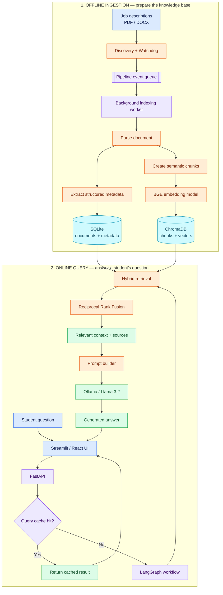

### Main data flow

| Stage | Input | Output | Main module |
|---|---|---|---|
| Discovery | Input directory | File events | `ingestion/discovery.py` |
| Parsing | PDF/DOCX file | Extracted text | `ingestion/parser.py` |
| Extraction | Parsed document | Structured fields | `extraction/` |
| Chunking | Parsed text | Text chunks | `chunking/semantic_chunker.py` |
| Embedding | Text chunks | Dense vectors | `embedding/embedding_pipeline.py` |
| Persistence | Metadata and vectors | SQLite + ChromaDB records | `storage/`, `vector_db/` |
| Retrieval | User query | Ranked evidence | `retrieval/` |
| Generation | Query + retrieved context | Natural-language response | `agents/`, `llm/` |

---

## How the Pipeline Works

### 1. Document discovery and ingestion

The application monitors the configured job-description directory. The discovery component identifies file events and sends them to a queue. A background indexing worker consumes those events and runs the processing pipeline.

The indexing worker handles three important event types:

- **New file:** parse and index the document.
- **Modified file:** remove stale indexed data and index the updated content.
- **Deleted file:** remove associated chunks and metadata and update the document status.

A document's status is tracked through the indexing lifecycle, including states such as indexing, indexed, deleted, and failed.

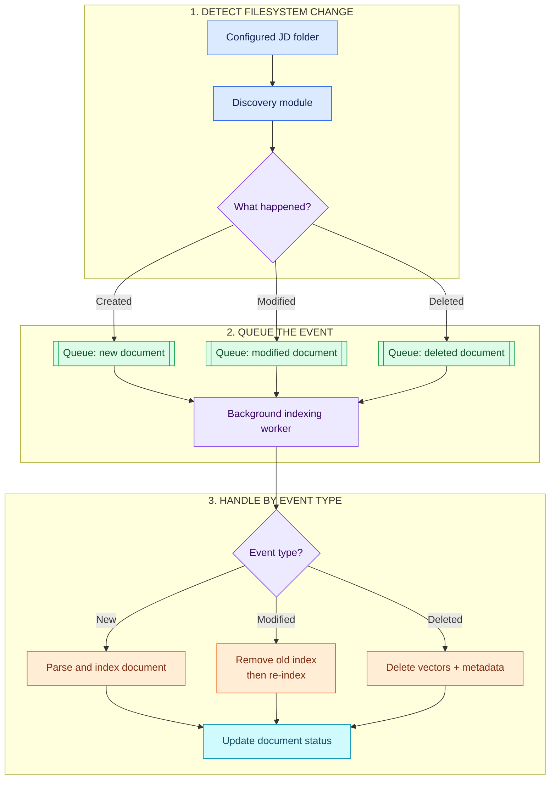

**Relevant modules:** `src/ingestion/discovery.py`, `src/ingestion/automatic_indexer.py`, and `src/ingestion/parser.py`.

#### The three ingestion components and their responsibilities

The ingestion implementation is split across three cooperating files. They are not three sequential file formats or three separate stages of extraction; each file owns a distinct responsibility:

| File | Responsibility | Main class / function |
|---|---|---|
| `discovery.py` | Find files, detect filesystem changes, identify duplicates, and enqueue work | `DocumentDiscoveryModule`, `DiscoveryEventHandler`, `compute_sha256()` |
| `parser.py` | Read PDF/DOCX contents and return a structured parsed-document object | `DocumentParserModule`, `PDFParser`, `DOCXParser` |
| `automatic_indexer.py` | Consume queued events and coordinate parsing, metadata extraction, chunking, embedding, and storage | `AutomaticIndexingModule` |

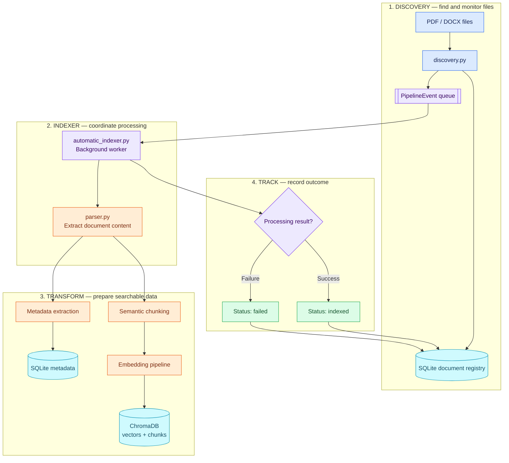

#### A. `discovery.py` — finding and monitoring documents

**1. Supported-file filtering**

The discovery module watches a configured directory recursively and accepts only PDF and DOCX files. The extension check is centralized in `is_supported_file()`:

```python
def is_supported_file(self, file_path: str) -> bool:
    _, ext = os.path.splitext(file_path.lower())
    return ext in {".pdf", ".docx"}
```

**2. Startup scan plus continuous monitoring**

When `start()` is called, the module first performs a full scan with `force_rescan()`. It then starts a Watchdog observer, so files added or changed after startup are also detected.

```python
def start(self):
    self.force_rescan()  # Reconcile folder contents with SQLite

    self.observer = Observer()
    handler = DiscoveryEventHandler(self)
    self.observer.schedule(
        handler,
        path=self.watched_dir,
        recursive=True
    )
    self.observer.start()
```

The startup scan is important: filesystem events only report changes observed while the watcher is running. A full scan also finds files that were already present before the application started.

**3. Duplicate detection using SHA-256**

The implementation hashes file bytes in 64 KB blocks. This avoids loading an entire large document into memory just to calculate its content fingerprint.

```python
def compute_sha256(file_path: str) -> str:
    hasher = hashlib.sha256()

    with open(file_path, "rb") as f:
        for chunk in iter(lambda: f.read(65536), b""):
            hasher.update(chunk)

    return hasher.hexdigest()
```

During a scan, the module checks both the file path and content hash:

- If the path is already registered and its hash changed, it queues a **modified** event.
- If the path is new but the same hash already exists for another registered document, it skips the duplicate.
- If neither the path nor hash exists, it creates a document record with status `pending` and queues a **new** event.

This distinguishes a file being renamed/copied from genuinely new document content.

**4. Debouncing filesystem events**

Some applications emit several modification events while one file is being saved. `FileDebouncer` suppresses repeated events of the same type for the same path within a 0.3-second window:

```python
def should_process(self, path: str, event_type: str) -> bool:
    now = time.time()
    key = (path, event_type)

    if now - self.last_events.get(key, 0.0) < self.window:
        return False

    self.last_events[key] = now
    return True
```

The Watchdog handler uses this check before forwarding created, modified, deleted, or moved-file events to the discovery module.

**5. Converting a filesystem change into a pipeline event**

Discovery does not parse a document itself. It creates a `PipelineEvent` and puts it on a thread-safe queue. The event contains an event ID, event type, document ID, path, extension, and timestamp.

```python
def _emit_event(self, event_type, doc_id, file_path):
    _, ext = os.path.splitext(file_path.lower())

    event = PipelineEvent(
        event_id=str(uuid.uuid4()),
        event_type=event_type,
        doc_id=doc_id,
        file_path=file_path,
        file_extension=ext,
        timestamp=datetime.datetime.now(datetime.timezone.utc)
    )

    self.event_queue.put(event)
```

**Discovery lifecycle**

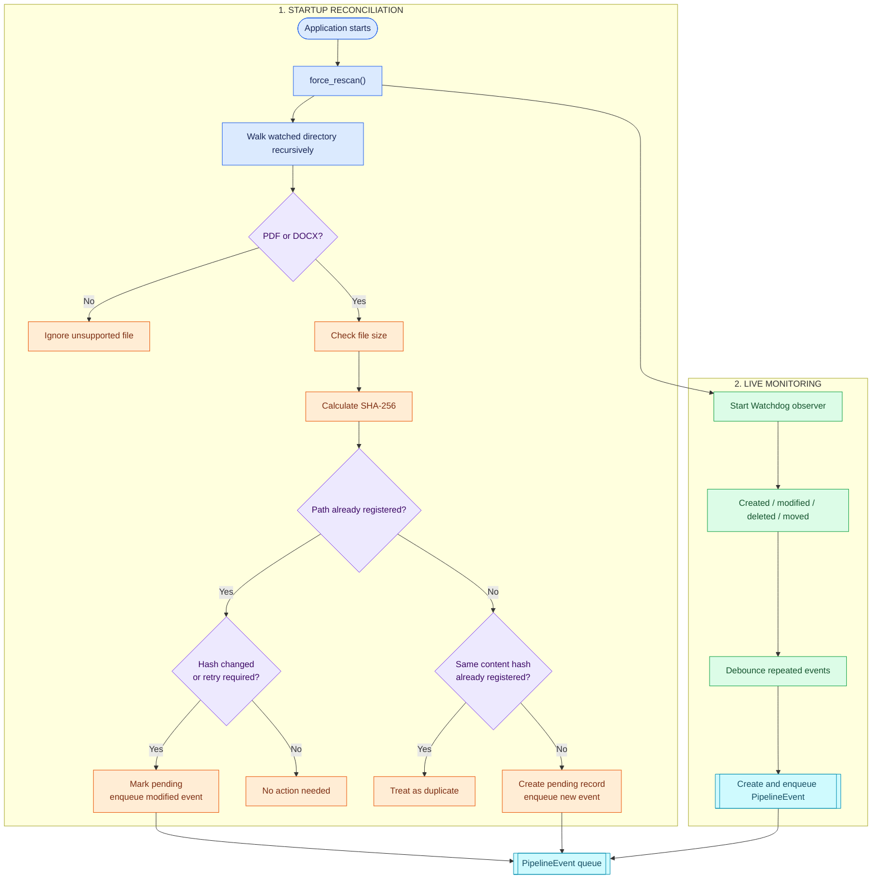

#### B. `parser.py` — extracting readable document content

The parser converts a file on disk into a `ParsedDocument`. The rest of the pipeline consumes this common structure rather than needing to know whether the source was a PDF or DOCX.

**1. Format dispatch**

`DocumentParserModule` checks the file extension and delegates to the corresponding parser:

```python
def parse_document(self, file_path: str, doc_id: str) -> ParsedDocument:
    if not os.path.exists(file_path):
        raise FileNotFoundError(file_path)

    _, ext = os.path.splitext(file_path.lower())

    if ext == ".pdf":
        return self.pdf_parser.parse(file_path, doc_id)
    elif ext == ".docx":
        return self.docx_parser.parse(file_path, doc_id)

    raise ValueError(f"Unsupported file format: {ext}")
```

**2. PDF parsing: native text first, OCR when needed**

The PDF parser uses PyMuPDF (`fitz`). It checks each page for a usable native text layer. If the page contains enough readable text, it extracts text blocks and tables. If the page appears scanned or image-only, it attempts OCR using PyMuPDF's Tesseract bridge.

```python
raw_native = page.get_text("text")
clean_native = _strip_watermark(raw_native)
has_real_text = len(clean_native.strip()) > 40

if has_real_text:
    # Extract native text, tables, blocks and heading information
    ...
else:
    # Scanned/image page: use OCR
    ocr_text = _ocr_page(page)
    ocr_text = _strip_watermark(ocr_text)
```

The parser also:
- Detects likely headings using font-size statistics and bold formatting.
- Extracts tables into headers, rows, and raw text.
- Removes repeated watermark/footer noise.
- Normalizes Unicode, whitespace, bullets, line endings, and words split by line-ending hyphens.
- Raises specific errors for protected, corrupted, scanned-without-readable-text, or empty documents.

> **OCR requirement:** the code calls PyMuPDF's `get_textpage_ocr()`, which relies on Tesseract being available to the runtime. OCR may fail if the required Tesseract installation or language data is missing.

**3. DOCX parsing: preserve paragraph and table order**

The DOCX parser uses `python-docx`. It walks the document body in order, handling paragraphs and tables as they appear. Paragraph styles beginning with `Heading` are used to identify section headings. Tables are converted into headers, rows, and plain-text representations so their contents are also searchable downstream.

```python
for child in doc.element.body:
    if child.tag.endswith("p"):
        body_elements.append(Paragraph(child, doc))
    elif child.tag.endswith("tbl"):
        body_elements.append(Table(child, doc))

for element in body_elements:
    if isinstance(element, Paragraph):
        text = element.text
        # Capture paragraph text and heading sections
        ...
    elif isinstance(element, Table):
        # Extract each row and cell
        ...
```

**4. Common parsed output**

Both parsers return a `ParsedDocument` containing fields such as:

| Field | Meaning |
|---|---|
| `doc_id` | Stable registry ID for the source document |
| `file_path` / `file_type` | Source location and format |
| `full_text` | Normalized full document text |
| `pages` | Page-level content and text blocks (PDF) |
| `sections` | Heading-based sections and their content |
| `tables` | Extracted table headers, rows, and raw text |
| `document_title` | Title from PDF/DOCX metadata when available |
| `page_count` | PDF page count; DOCX currently reports 0 |
| `char_count` | Number of characters in normalized text |

The common data model is defined in `src/ingestion/models.py` (`ParsedDocument`, `ParsedPage`, `ParsedSection`, `ParsedTable`, and `TextBlock`).

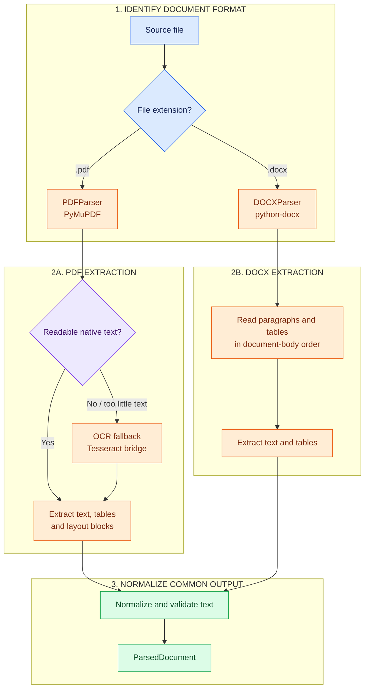

#### C. `automatic_indexer.py` — processing events in the background

The automatic indexer is the consumer of the queue populated by discovery. It owns a background worker thread and coordinates the document-processing components.

**1. Start the worker thread**

```python
def start(self):
    if self.is_running:
        return

    self.is_running = True
    self._stop_event.clear()

    self.worker_thread = threading.Thread(
        target=self._worker_loop,
        name="IndexingWorker",
        daemon=True
    )
    self.worker_thread.start()
```

The worker waits for a `PipelineEvent`, processes it, and marks the queue task complete. It continues until the stop event is set.

```python
def _worker_loop(self):
    while not self._stop_event.is_set():
        try:
            event = self.event_queue.get(timeout=1.0)
        except queue.Empty:
            continue

        try:
            self._process_event(event)
        finally:
            self.event_queue.task_done()
```

**2. Handle new, modified, and deleted events**

For a deleted file, the indexer removes its ChromaDB chunks and SQLite metadata, then marks the registry entry as deleted.

For a new or modified file, the indexer runs the full indexing pipeline. A modified document is cleaned up first so old chunks and metadata are not left alongside the new version.

```python
if event.event_type == "deleted":
    self.chroma_manager.delete_document_chunks(event.doc_id)
    meta_repo.delete_metadata(event.doc_id)
    doc_repo.update_document_status(event.doc_id, "deleted")
    session.commit()

elif event.event_type in ["new", "modified"]:
    if event.event_type == "modified":
        self.chroma_manager.delete_document_chunks(event.doc_id)
        meta_repo.delete_metadata(event.doc_id)

    doc_repo.update_document_status(event.doc_id, "indexing")
    session.commit()

    parsed_doc = self.parser_module.parse_document(
        event.file_path, event.doc_id
    )
    metadata_dict, report = self.metadata_extractor.extract_metadata(parsed_doc)
    meta_repo.insert_metadata(event.doc_id, metadata_dict)
    chunks = self.chunker.chunk_document(parsed_doc, metadata_dict)
    embedded_chunks = self.embedding_pipeline.embed_chunks(chunks)
    self.chroma_manager.upsert_chunks(embedded_chunks)

    doc_repo.update_document_status(event.doc_id, "indexed", indexed_at=now_str)
    session.commit()
```

**3. The complete indexing sequence**

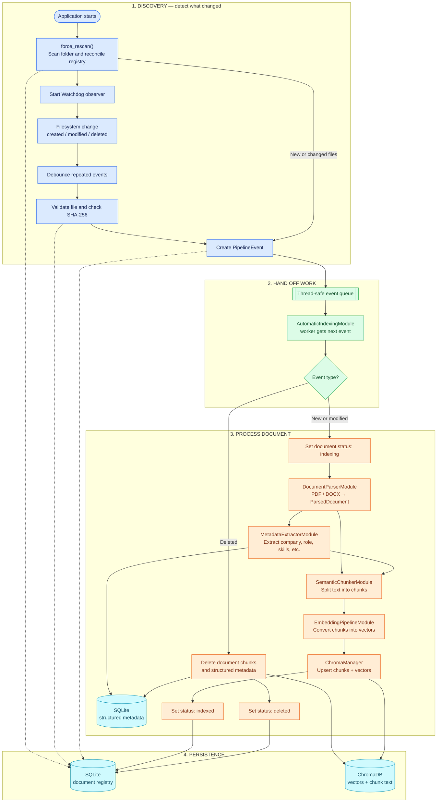

**4. Failure handling and cache invalidation**

If an indexing step raises an exception, the indexer rolls back the current database transaction where possible and attempts to set the document status to `failed`, recording the failure reason. After successful indexing or deletion, it clears the query and analytics caches when those caches are configured.

The status information exposed by `get_status()` includes whether the worker is running, queue depth, current file, indexed and failed counts, and the last successful indexing timestamp.

#### Putting the three files together

A useful way to remember the separation of concerns is:

- **Discovery asks:** “What changed in the watched folder?”
- **Parser asks:** “What information can I read from this file?”
- **Automatic indexer asks:** “What should the system do with this parsed document so it becomes searchable?”

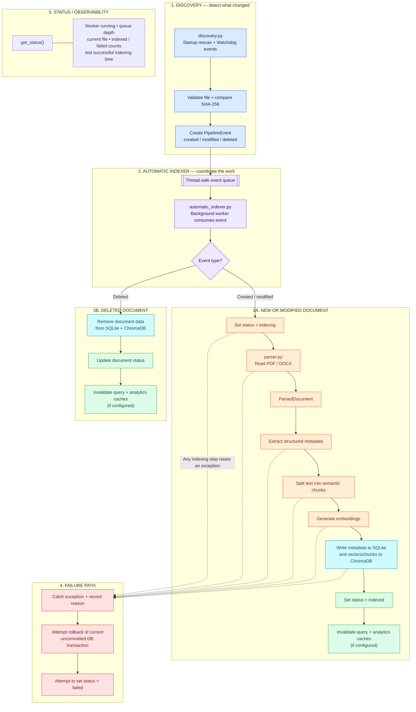

### 2. Metadata extraction

Metadata extraction converts unstructured job-description text into structured fields that can be filtered and compared. The extraction package separates the orchestration logic from individual extraction strategies.

The intended layered strategy is:

1. **Rule-based extraction:** regular expressions and deterministic patterns for fields with recognizable formats, such as CGPA, compensation, and experience.
2. **NLP-based extraction:** identify entities and useful phrases from natural language.
3. **LLM-based extraction:** handle fields that are difficult to capture reliably using fixed patterns alone.
4. **Validation and normalization:** prepare extracted values for structured storage.

Examples of useful metadata include company name, role title, job type, package/CTC, CGPA cutoff, deadline, locations, eligible branches, and skills.

```mermaid
flowchart TB
    subgraph INPUT["1. INPUT — parsed job description"]
        DOC["ParsedDocument<br/>full_text + document ID"] --> ORCH["MetadataExtractorModule<br/>coordinates extraction"]
    end

    subgraph RULES["2. RULE-BASED EXTRACTION — exact patterns"]
        ORCH --> REGEX["RuleBasedExtractor<br/>Regex + deterministic patterns"]
        REGEX --> R_FIELDS["Company • role • CGPA<br/>CTC • stipend • duration • deadline"]
    end

    subgraph NLP["3. NLP-BASED EXTRACTION — enrich partial results"]
        R_FIELDS --> NLP_MOD["NLPExtractor<br/>Known skills, branch mappings,<br/>locations + experience patterns"]
        NLP_MOD --> PARTIAL["PartialMetadata<br/>values + per-field confidence scores"]
    end

    subgraph DECISION["4. CONFIDENCE CHECK — decide whether LLM is needed"]
        PARTIAL --> CHECK["Check core fields<br/>missing or confidence below 0.70"]
        CHECK --> CONTEXT{"Field relevant to<br/>job type?"}
        CONTEXT -->|No — e.g. stipend for FTE| SKIP["Skip irrelevant field"]
        CONTEXT -->|Yes| MISSING{"Any core fields<br/>still missing / low confidence?"}
        MISSING -->|No| NORMALIZE
        MISSING -->|Yes| LLM["LLMExtractor — local Ollama<br/>request only missing fields"]
        LLM --> MERGE["Merge extracted values<br/>into PartialMetadata"]
        MERGE --> NORMALIZE["Normalize and validate values"]
    end

    subgraph OUTPUT["5. OUTPUT — structured result + extraction report"]
        NORMALIZE --> VALID["Validate values<br/>e.g. CGPA between 0 and 10"]
        VALID --> DATA["Normalized metadata dictionary"]
        VALID --> REPORT["ExtractionReport<br/>field confidence • source strategy<br/>missing fields • LLM called • duration"]
        DATA --> SQLITE[("SQLite<br/>structured job metadata")]
    end

    SKIP --> MISSING

    classDef input fill:#dbeafe,stroke:#2563eb,color:#172554
    classDef rules fill:#ffedd5,stroke:#ea580c,color:#7c2d12
    classDef nlp fill:#dcfce7,stroke:#16a34a,color:#14532d
    classDef decision fill:#ede9fe,stroke:#7c3aed,color:#3b0764
    classDef llm fill:#fce7f3,stroke:#db2777,color:#831843
    classDef output fill:#cffafe,stroke:#0891b2,color:#164e63
    class DOC,ORCH input
    class REGEX,R_FIELDS rules
    class NLP_MOD,PARTIAL nlp
    class CHECK,CONTEXT,SKIP,MISSING decision
    class LLM,MERGE llm
    class NORMALIZE,VALID,DATA,REPORT,SQLITE output
```

**Relevant modules:** `src/extraction/metadata_extractor.py`, `rule_extractor.py`, `nlp_extractor.py`, `llm_extractor.py`, and `models.py`.

### 3. Semantic chunking and embeddings

A complete job description may contain many unrelated sections. Searching the entire document as one unit can make it harder to retrieve the exact evidence needed for a question.

The chunking stage splits document text into smaller sections. The configured chunk size and overlap help preserve context across adjacent chunks. The embedding pipeline then converts each chunk into a numerical vector using the configured Sentence Transformers model.

The current configuration specifies:

- Embedding model: `BAAI/bge-small-en-v1.5`
- Batch size: `32`
- Chunk size: `400` tokens
- Chunk overlap: `60` tokens

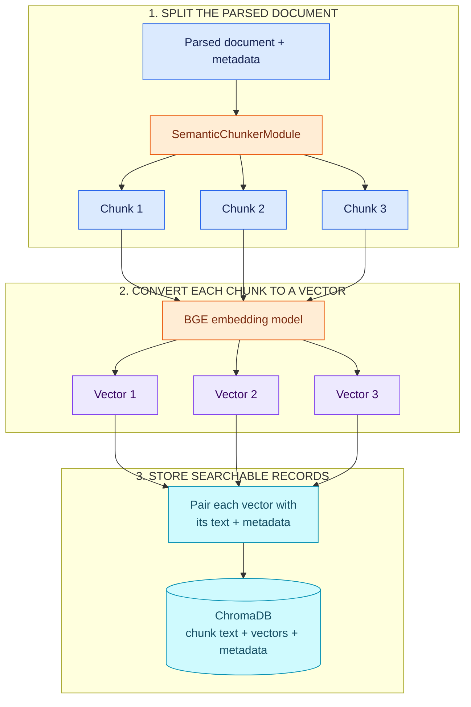

At query time, the same embedding model is used to embed the user's question. The vector database can then retrieve chunks that are semantically close to the query.

**Relevant modules:** `src/chunking/semantic_chunker.py` and `src/embedding/embedding_pipeline.py`.

#### What one chunk actually contains

A chunk is not just a piece of text. Your code creates a `TextChunk` object that carries the text together with identifiers and contextual fields. The embedding pipeline converts the `content` into a 384-dimensional vector (the output size of `BAAI/bge-small-en-v1.5`) and creates an `EmbeddedChunk` that retains the chunk's identity and metadata.

For example, a chunk from a Google Software Engineer internship JD might look conceptually like this:

```python
TextChunk(
    chunk_id="chunk-uuid-001",
    doc_id="document-uuid-123",
    chunk_index=2,
    chunk_type="text",
    content="Section: Required Skills\\n\\nCandidates should know Python, C++ and Docker...",
    token_count=118,
    section_heading="Required Skills",
    page_number=2,
    company_name="Google",
    role_title="Software Engineer Intern",
    job_type="internship"
)
```

The exact values above are illustrative; IDs are generated at runtime. The fields have these roles:

| Field | What it stores | Why it matters |
|---|---|---|
| `chunk_id` | Unique ID for this chunk | Identifies the vector record in ChromaDB |
| `doc_id` | ID of the source job-description document | Connects multiple chunks to the same JD |
| `chunk_index` | Position in the document's chunk sequence | Preserves document order |
| `chunk_type` | `text` or `table` | Distinguishes paragraph-based and table chunks |
| `content` | Actual chunk text, including section heading prefix when available | Text returned as retrieval evidence |
| `token_count` | Estimated token count | Helps control chunk size |
| `section_heading` | Heading associated with the section | Adds context about what the chunk describes |
| `page_number` | Source page, when available | Helps trace evidence back to the document |
| `company_name`, `role_title`, `job_type` | Selected document-level metadata | Supports filtering and gives each chunk context |

#### How the chunk, vector, and metadata are stored

The embedding is a numerical representation of the chunk's **content**. It is not a replacement for the text or metadata. ChromaDB stores them together as one record:

- **ID:** `chunk_id`
- **Document:** the original chunk text (`content`)
- **Embedding:** a 384-number vector generated from that text
- **Metadata:** `doc_id`, `chunk_index`, `chunk_type`, `content_hash`, and available fields such as section heading, page, company, role, and job type

A simplified view of one vector is:

```text
[0.021, -0.114, 0.008, 0.237, ..., -0.041]
  dim 1   dim 2   dim 3   dim 4       dim 384
```

Each number is a learned feature from the embedding model. Individual dimensions do not correspond directly to labels such as “Python” or “salary”; the vector represents the overall semantic content.

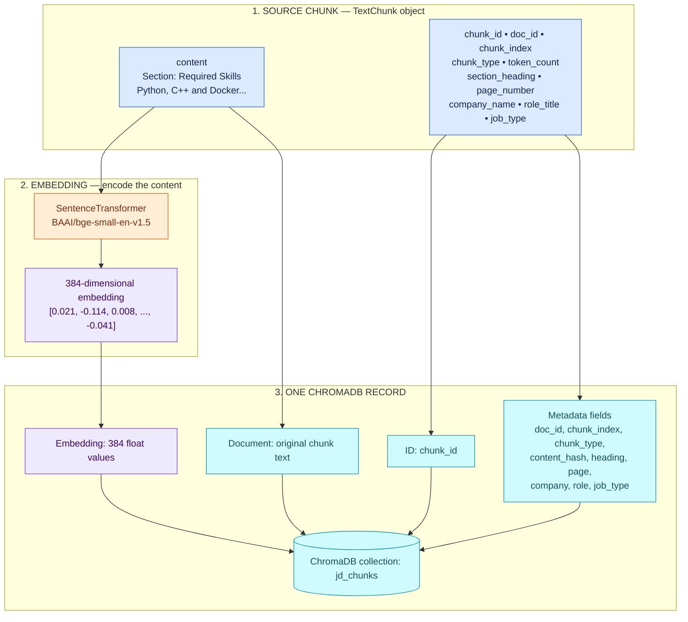

#### How ChromaDB stores and retrieves a chunk

The following diagram separates the **write path** (adding embedded chunks to a collection) from the **query path** (finding relevant chunks). Each chunk is stored as one logical record, while ChromaDB manages the persistent data and vector-search index behind the collection.

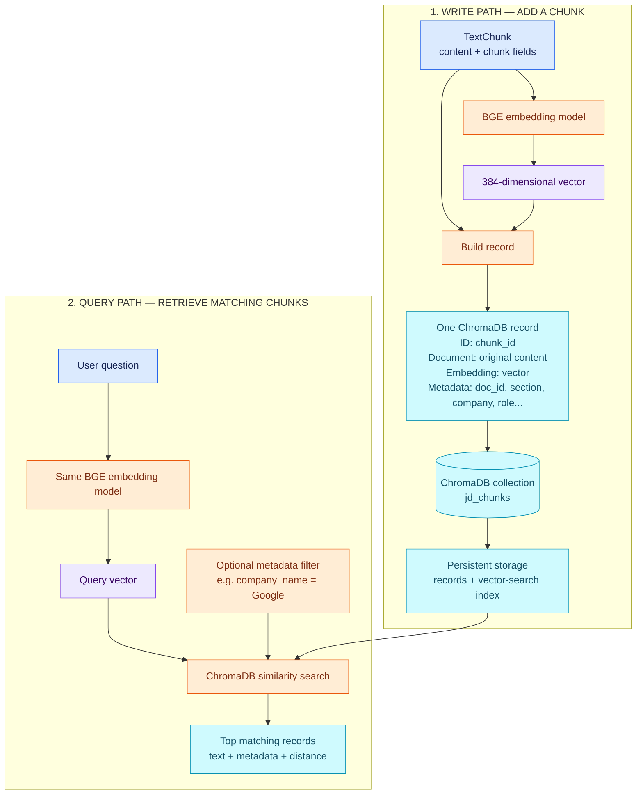

For a query, the application embeds the question with the same embedding model and asks the collection for nearest matching records. Metadata filters can narrow the search (for example, to a particular company); the returned records provide the original chunk text and its metadata as evidence.

The embedding pipeline also uses a SQLite cache keyed by the SHA-256 hash of the chunk text and the embedding model name. If the same content has already been embedded with the same model, the cached vector can be reused instead of running the model again. The cache is separate from ChromaDB's searchable chunk records.

**Implementation detail:** the chunker estimates tokens using approximately `1.3 × whitespace-separated word count`, rather than a model tokenizer. Although the configuration exposes `chunk_overlap: 60`, the current implementation carries over previous paragraph(s) or sentence fragments when starting the next chunk; it does not enforce an exact 60-token overlap. The README's 60-token value is therefore the configured target, not a guaranteed measured overlap.


### 4. Storage layer

The project uses two storage systems because structured filtering and semantic similarity search are different workloads.

| Store | What it contains | Best suited for |
|---|---|---|
| SQLite | Document registry and structured JD metadata | Exact filters, eligibility checks, aggregation |
| ChromaDB | Embedded text chunks and associated metadata | Meaning-based similarity search |

For example:

- “Show roles with a CGPA cutoff below 7.5” is primarily a structured filtering problem.
- “Find jobs involving retrieval-augmented generation” is primarily a semantic retrieval problem.
- “Find RAG roles in Bengaluru with a CGPA cutoff below 7.5” can benefit from both.

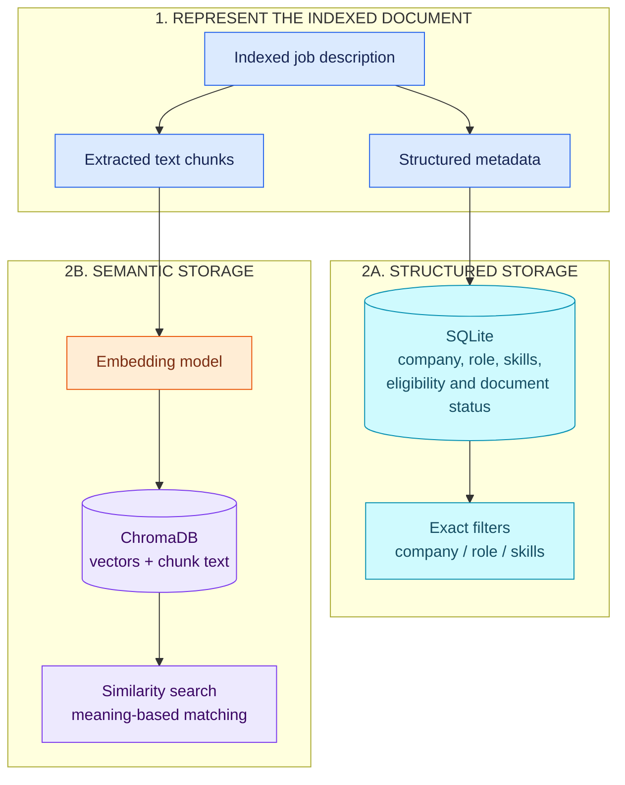

**Relevant modules:** `src/storage/sqlite_manager.py` and `src/vector_db/chroma_manager.py`.

### 5. Hybrid retrieval and rank fusion

Hybrid retrieval combines structured metadata search with vector similarity search.

1. The query is inspected for useful entities and filters.
2. SQLite is queried when structured filters are available.
3. The query is embedded and ChromaDB retrieves semantically similar chunks.
4. The result-fusion component combines the ranked results.
5. Retrieved chunks and metadata are assembled into context for the agent.

The implementation uses **Reciprocal Rank Fusion (RRF)**. It combines result positions rather than directly comparing raw scores from different retrieval systems.

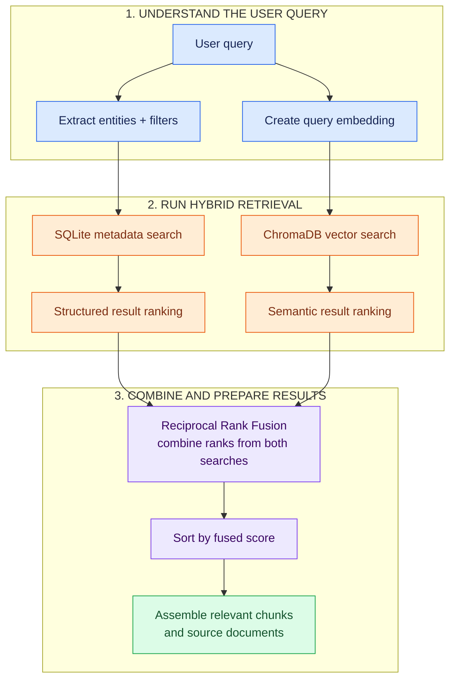

The RRF score for a document is calculated as:

```text
RRF(d) = Σ 1 / (k + rank_r(d))
```

Here, `rank_r(d)` is the position of document `d` in retriever `r`, and the implementation uses `k = 60`. A document appearing near the top of multiple result lists receives a higher combined score.

**Relevant modules:** `src/retrieval/hybrid_retriever.py` and `src/retrieval/result_fusion.py`.

### 6. Intent detection and agent workflow

The intent detector classifies a question into a query category using keyword and pattern rules. The categories implemented include:

| Intent | Example question | Purpose |
|---|---|---|
| Search | “Find ML engineer roles” | Search job descriptions |
| Compare | “Compare Company A vs Company B” | Compare opportunities |
| Recommend | “Which jobs match my profile?” | Apply profile/eligibility criteria |
| Analytics | “What is the average package?” | Explore aggregate placement information |
| Summary | “Summarize this role” | Explain a role or JD |
| Follow-up | “What about that company’s deadline?” | Resolve a reference to earlier conversation context |

LangGraph coordinates the workflow using a shared state. Nodes update parts of that state, and graph routing determines which operation should run next. The graph also uses a SQLite-backed checkpointer for conversation/thread persistence.

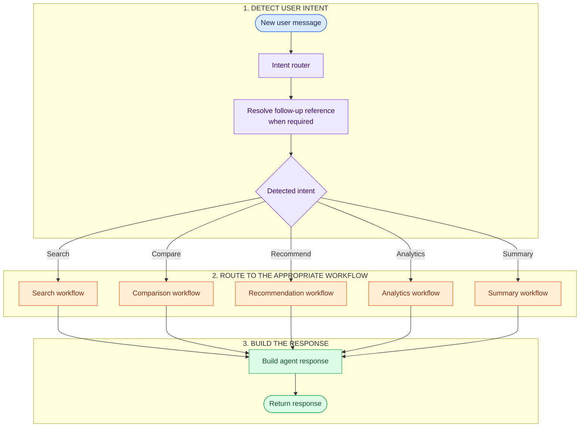

The exact operations differ by intent. For example, recommendations can apply student profile filters before semantic ranking, while comparisons collect metadata for the companies mentioned in the question.

**Relevant modules:** `src/retrieval/intent_detector.py` and `src/agents/agent_graph.py`.

### 7. Prompt construction and LLM response

After retrieval, the system assembles relevant document context and passes it to the prompt builder. The Ollama client sends the prompt to the locally running model.

The model is configured through `config.yaml`; the current default is `llama3.2:latest` at `http://localhost:11434`, with temperature `0.1` and a timeout of `120` seconds.

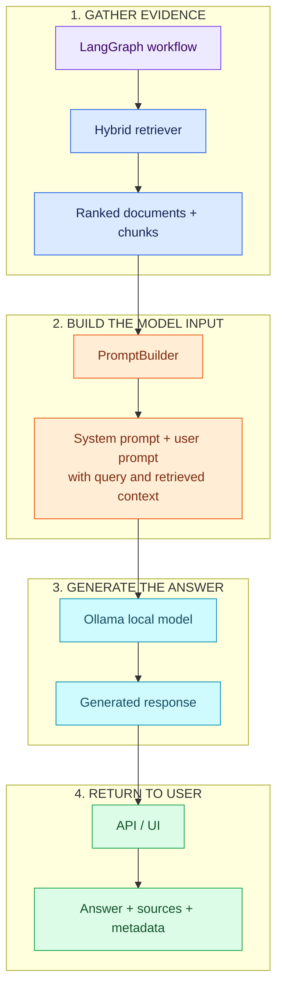

The retrieved evidence is included in the prompt so that the response can be grounded in the indexed job descriptions instead of relying only on the model's general knowledge.

**Relevant modules:** `src/llm/prompt_builder.py` and `src/llm/ollama_client.py`.

---

## Frontend and Backend

The repository contains a FastAPI backend and two frontend implementations:

- **Streamlit:** `frontend.py`, runnable directly from the repository root.
- **React + Vite:** the `ui/` directory, with pages and reusable components for chat, browsing, analytics, and profile workflows.

The frontend communicates with the backend API. The backend initializes storage, retrieval, the LangGraph agent, caches, and background indexing services during application startup.

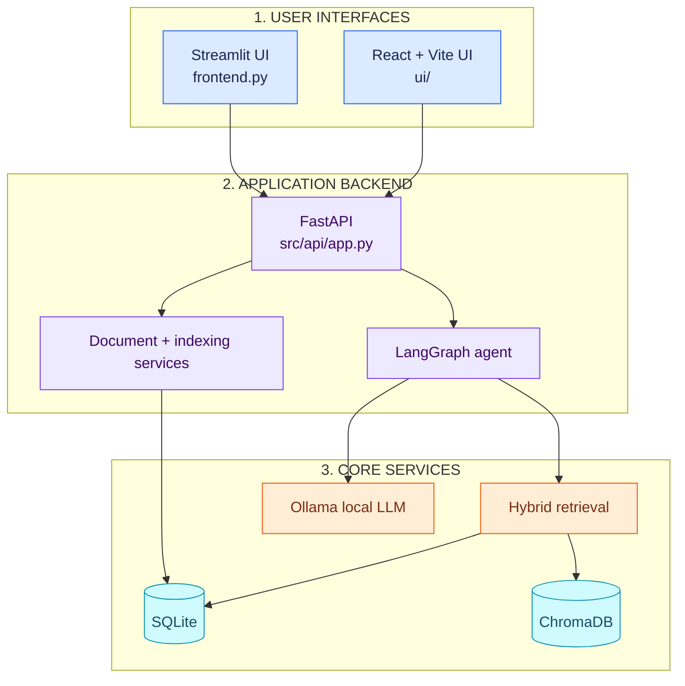

---

## Technology Stack

| Layer | Technology | Role |
|---|---|---|
| Programming language | Python | Backend and processing pipeline |
| API framework | FastAPI | REST API |
| Workflow orchestration | LangGraph | Stateful agent workflow |
| LLM runtime | Ollama | Local inference |
| Configured LLM | Llama 3.2 | Natural-language generation |
| Embedding model | BAAI/bge-small-en-v1.5 | Text and query embeddings |
| Vector database | ChromaDB | Vector storage and similarity search |
| Relational database | SQLite / SQLAlchemy | Structured metadata and checkpoint storage |
| Document parsing | PyMuPDF, python-docx | PDF and DOCX extraction |
| Streamlit frontend | Streamlit | Python-based UI |
| React frontend | React, Vite, Tailwind CSS | Web UI |
| Configuration | YAML / Pydantic | Application settings and data validation |

---

## Repository Structure

The main repository layout is:

```text
job_description_agent/
├── config.yaml
├── main.py
├── frontend.py
├── requirements.txt
├── setup.sh
├── setup.bat
├── start.sh
├── start.bat
├── stop.sh
├── test_setup.py
├── project_explanation.tex
│
├── src/
│   ├── agents/
│   │   └── agent_graph.py
│   ├── api/
│   │   └── app.py
│   ├── chunking/
│   │   └── semantic_chunker.py
│   ├── embedding/
│   │   └── embedding_pipeline.py
│   ├── extraction/
│   │   ├── llm_extractor.py
│   │   ├── metadata_extractor.py
│   │   ├── models.py
│   │   ├── nlp_extractor.py
│   │   └── rule_extractor.py
│   ├── ingestion/
│   │   ├── automatic_indexer.py
│   │   ├── discovery.py
│   │   ├── models.py
│   │   └── parser.py
│   ├── llm/
│   │   ├── ollama_client.py
│   │   └── prompt_builder.py
│   ├── retrieval/
│   │   ├── hybrid_retriever.py
│   │   ├── intent_detector.py
│   │   ├── query_cache.py
│   │   └── result_fusion.py
│   ├── storage/
│   │   └── sqlite_manager.py
│   ├── vector_db/
│   │   └── chroma_manager.py
│   └── config.py
│
├── tests/
│   ├── test_agent_graph.py
│   ├── test_api_endpoints.py
│   ├── test_extraction.py
│   ├── test_indexing_worker.py
│   ├── test_ingestion.py
│   ├── test_performance_cache.py
│   ├── test_retrieval_llm.py
│   └── test_vector_store.py
│
└── ui/
    ├── package.json
    └── src/
        ├── components/
        ├── lib/
        └── pages/
```

---

## Configuration

The main configuration is stored in the root-level `config.yaml`.

| Setting | Current value | Description |
|---|---|---|
| `paths.jd_files` | `jd_files` | Folder watched for job descriptions |
| `paths.chroma_db` | `data/chroma` | ChromaDB persistence path |
| `paths.sqlite_db` | `data/metadata.db` | SQLite database path |
| `embedding.model` | `BAAI/bge-small-en-v1.5` | Embedding model |
| `embedding.batch_size` | `32` | Embedding batch size |
| `chunking.chunk_size` | `400` | Target chunk size in tokens |
| `chunking.chunk_overlap` | `60` | Overlap between chunks |
| `llm.model` | `llama3.2:latest` | Ollama model name |
| `llm.base_url` | `http://localhost:11434` | Ollama API base URL |
| `llm.temperature` | `0.1` | Generation temperature |
| `llm.timeout_seconds` | `120` | LLM request timeout |
| `retrieval.top_k` | `5` | Configured retrieval count |
| `api.host` | `0.0.0.0` | API bind host |
| `api.port` | `8000` | API port |
| `logging.level` | `INFO` | Logging level |

Example configuration:

```yaml
paths:
  jd_files: "jd_files"
  chroma_db: "data/chroma"
  sqlite_db: "data/metadata.db"

embedding:
  model: "BAAI/bge-small-en-v1.5"
  batch_size: 32
  instruction: "Represent this job description for retrieval: "

chunking:
  chunk_size: 400
  chunk_overlap: 60

llm:
  model: "llama3.2:latest"
  base_url: "http://localhost:11434"
  temperature: 0.1
  timeout_seconds: 120

retrieval:
  top_k: 5

api:
  host: "0.0.0.0"
  port: 8000

logging:
  level: "INFO"
```

---

## Getting Started

### Prerequisites

- Python 3.10 or a compatible Python version for the installed dependencies.
- Git.
- Ollama installed locally.
- Node.js and npm only if you want to run the React frontend.
- Job-description PDFs or DOCX files to index.

### 1. Clone the repository

```bash
git clone https://github.com/pratik-0302/job_description_agent.git
cd job_description_agent
```

### 2. Create a virtual environment

**macOS / Linux**

```bash
python3 -m venv .venv
source .venv/bin/activate
```

**Windows PowerShell**

```powershell
python -m venv .venv
.venv\Scripts\Activate.ps1
```

### 3. Install Python dependencies

```bash
pip install -r requirements.txt
```

### 4. Install and start Ollama

Install Ollama using the instructions for your operating system, then pull the configured model:

```bash
ollama pull llama3.2
ollama serve
```

The configured local API URL is `http://localhost:11434`. Keep the Ollama service running while using LLM-powered features.

### 5. Add job descriptions

Create the configured input directory if it does not exist, then place your PDF and DOCX files inside it:

```bash
mkdir -p jd_files
```

The discovery and indexing services start with the FastAPI application and process file events in the background.

---

## Running the Application

### Start the backend

From the repository root, with the virtual environment active:

```bash
python main.py
```

The backend uses the host and port from `config.yaml`. With the default configuration, it is available at:

- API base: `http://localhost:8000`
- Interactive API docs: `http://localhost:8000/docs`

### Run the Streamlit frontend

Open another terminal from the repository root:

```bash
streamlit run frontend.py
```

### Run the React frontend

Open another terminal:

```bash
cd ui
npm install
npm run dev
```

Use the local URL printed by Vite. Ensure the React UI's API configuration points to the running FastAPI backend.

### Application startup sequence

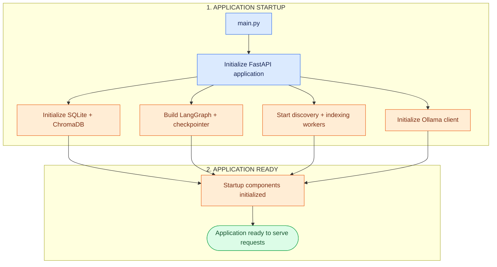

---

## API Endpoints

The following routes are defined in `src/api/app.py`.

| Method | Endpoint | Purpose |
|---|---|---|
| GET | `/api/index/health` | Check SQLite, ChromaDB, Ollama, and indexed-document health |
| GET | `/api/index/status` | Get background indexing status |
| POST | `/api/index/scan` | Trigger a filesystem rescan |
| POST | `/api/query` | Submit a natural-language query |
| GET | `/api/documents` | List indexed documents |
| GET | `/api/documents/{doc_id}` | Get a document's details |
| GET | `/api/analytics/summary` | Retrieve analytics summary |
| PUT | `/api/profile/{session_id}` | Update a student's profile |
| POST | `/api/upload` | Upload a job-description document |

### Query request example

```json
{
  "query_text": "Find machine learning roles suitable for my profile",
  "session_id": "student-session-001"
}
```

The query response model includes the response text, agent type, source documents, optional structured data, follow-up suggestions, confidence, and generation time.

---

## Testing

The repository includes tests for the main application layers:

| Test file | Area covered |
|---|---|
| `tests/test_ingestion.py` | Document ingestion |
| `tests/test_extraction.py` | Metadata extraction |
| `tests/test_vector_store.py` | Vector-store operations |
| `tests/test_retrieval_llm.py` | Retrieval and LLM integration |
| `tests/test_agent_graph.py` | Agent workflow |
| `tests/test_api_endpoints.py` | API routes |
| `tests/test_indexing_worker.py` | Background indexing |
| `tests/test_performance_cache.py` | Cache behavior |

Run the test suite from the repository root:

```bash
pytest
```

If pytest is not installed in the environment, install it before running the tests.

---

## Design Decisions

### Why use both SQLite and ChromaDB?

Structured fields such as CGPA cutoff, company, and location are suited to relational filters. Semantic questions are better handled by vector similarity. Using both supports exact constraints and natural-language relevance.

### Why use RRF?

SQL and vector retrieval can return scores on different scales. RRF combines ranking positions instead of assuming those raw scores are directly comparable.

### Why use a local LLM?

Ollama provides a local inference endpoint for the configured model. This avoids requiring a hosted LLM API for the generation path, although local hardware still determines inference speed and resource usage.

### Why use LangGraph?

The application has multiple intent-specific workflows and shared query state. LangGraph makes the nodes, state transitions, and conversation checkpointing explicit.

### Why background indexing?

File discovery and document processing can take time. A queue and worker allow the API service to start indexing work asynchronously rather than requiring every file to be processed during a user query.

---

## Limitations and Future Improvements

Potential improvements include:

- Add OCR support for scanned PDFs and improve extraction from complex tables and multi-column layouts.
- Add confidence scores and stronger validation for extracted metadata.
- Evaluate retrieval quality using a labeled set of placement queries and ranking metrics such as Recall@K and MRR.
- Add more robust intent classification beyond keyword/pattern rules.
- Add explicit source-grounding checks and answer evaluation.
- Add authentication, authorization, and restrictive CORS settings before exposing the API outside a trusted local environment.
- Add deployment configuration, monitoring, and structured tracing for indexing and query workflows.
- Add integration tests for the complete document-to-answer lifecycle.
- Improve resilience for unavailable Ollama service, malformed documents, and partial indexing failures.

---

## Contributing

Suggestions and improvements are welcome. For larger changes, open an issue describing the proposed change before submitting a pull request. Please include tests for changes to ingestion, extraction, retrieval, or agent behavior.

## License

No license file is currently present in the repository. Add a license if you intend to define permissions for reuse and distribution.
